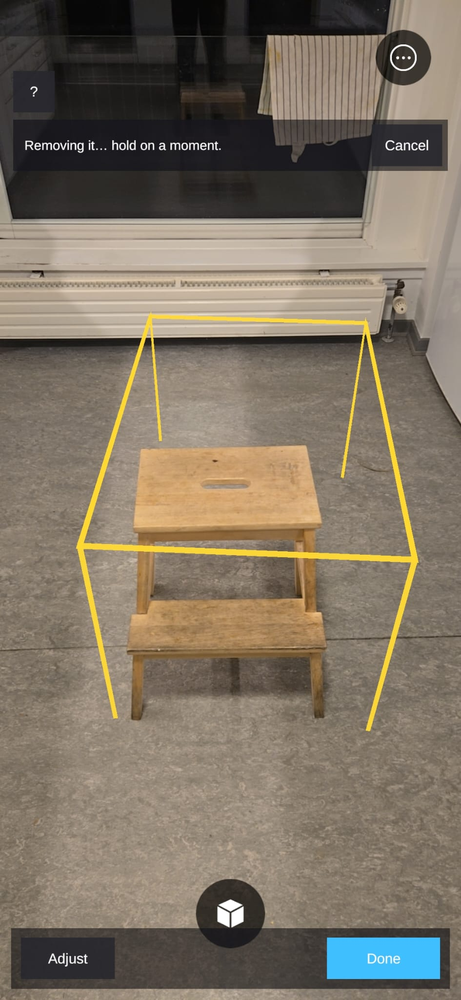
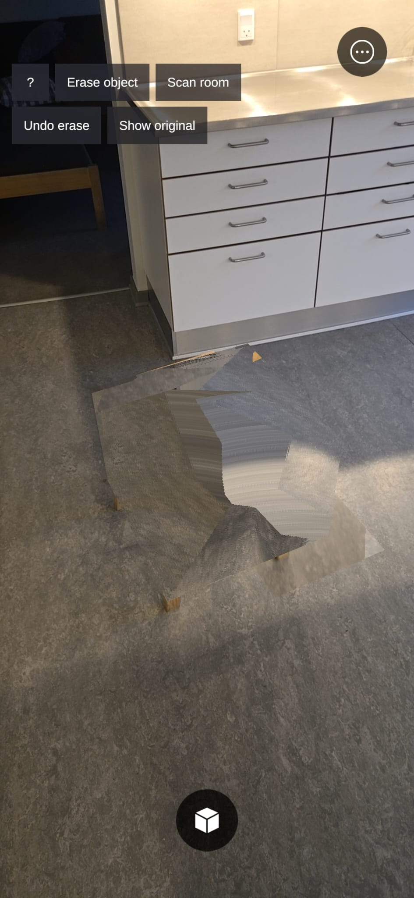
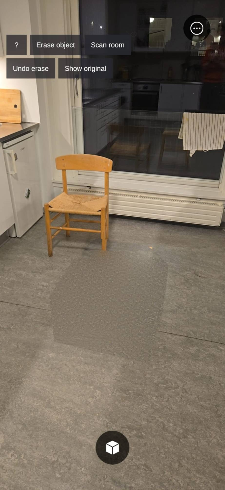
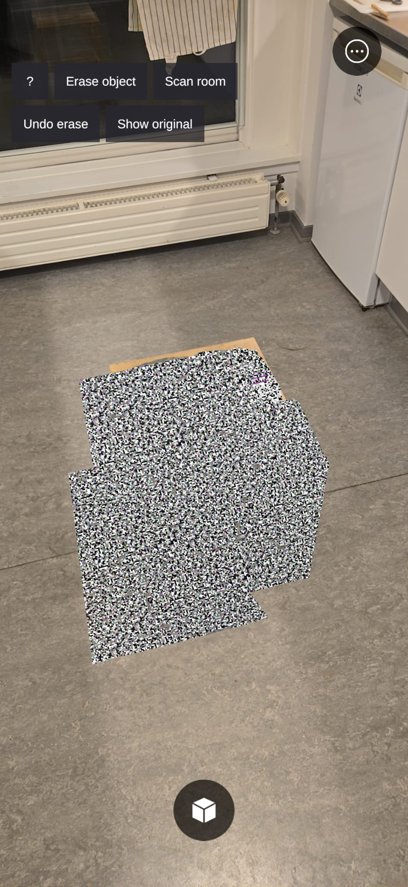

# MoveIt, Week 4: Removing Real Objects

**Author:** Josip Brljevic

By this point, MoveIt could place furniture in the room, but most real rooms already have furniture in them. If you want to see how a new sofa would look, you often have to imagine the room without the old one. So the goal for this week was to add an **Erase object** tool, where you tap a real object and the app hides it from the camera view.

Normally AR is about adding virtual things to the real world. Removing real things is called **diminished reality**, and it turned out to be a lot harder. The app has to know exactly which part of the image is the object, it has to make up what is behind it, since the camera never saw that, and the result has to stay in place when you walk around.

The first step was finding the object. For this we used ARCore's depth image, which tells you how far away every pixel is. Our test phone, a Samsung Galaxy S24, does not have a depth sensor, so ARCore estimates the depth from how the image changes as the phone moves. It is not very precise, but it was good enough. When you tap an object, the depth points around the tap are separated from the floor and walls that ARCore already detected, and a box is fitted around what is left. This box is shown in yellow. If the box does not fit well, the **Adjust** button lets you move, rotate and resize it. While you do that, you still see the normal camera view, and the object only disappears when you press **Done**.

  

Our first attempt at hiding the object copied pixels from around the object onto it every frame. It worked, but it looked smeared and flickered when the camera moved. We changed it to work on a single photo instead. When the box appears, the app takes one photo of the camera image and marks two areas in it: the object, using the depth to make sure only the object is marked and not the floor behind it, and the floor around it, which is the area we are allowed to copy from. Then it fills the object area using **PatchMatch** (Barnes et al., 2009), which is the same idea as Photoshop's content-aware fill. For every small patch in the gap, it looks for the most similar patch of floor and copies it in. This is done first at a low resolution and then at higher ones, so that bigger patterns like floorboards line up before the small details are added. Because we only copy from the floor, pieces of other furniture never end up in the gap. The whole thing runs in the background and takes about 3-4 seconds on the phone.

  
  

<em>Left: our first attempt, copying pixels live. Right: the final version, using the inpainted photo.</em>

Once the photo is filled, it has to be shown in the right place. The app remembers where the camera was when the photo was taken, and a shader projects the filled photo back onto the real floor in 3D. The erased area is attached to an AR anchor, so it stays in place while you walk around the room. From steep side angles the photo does not cover everything, so we also build a top-down map of the floor around the object, which is used for the parts the photo cannot see.

Testing this on a phone every time was slow, so we built an automatic test in Unity's XR Simulation. It scans a simulated bedroom, erases an object and takes screenshots from different angles. We could even make the depth noisy, like on the real phone. This helped us find problems like the side of a bed next to a stool also getting erased, which we fixed by keeping the box 10 cm away from nearby furniture.

The worst bug only appeared on the real phone. After a few seconds, the erased area turned into grey static, like an old TV. We saved the images from each step to the phone's storage and found that the photo itself was broken, because reading a full-resolution image failed on the phone's graphics driver. Taking the photo at 720 px and retaking it when it comes out broken fixed the problem.

  

By the end of the week, you could tap a real object, check the yellow box and remove the object from the room. It is not perfect: the filled area is only a guess of what is under the object, it works best on floors with repeating patterns like wood or carpet, and objects touching other furniture are hard to separate. A phone with a real depth sensor would make every step better, but we were happy with how well it works on a normal phone.
