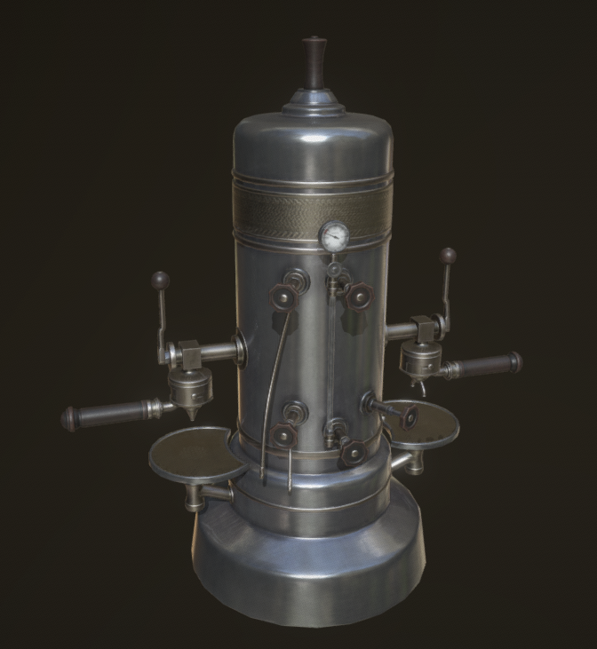
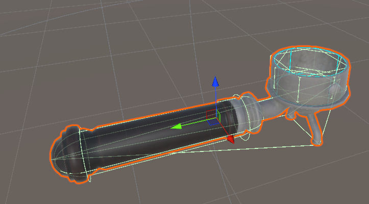
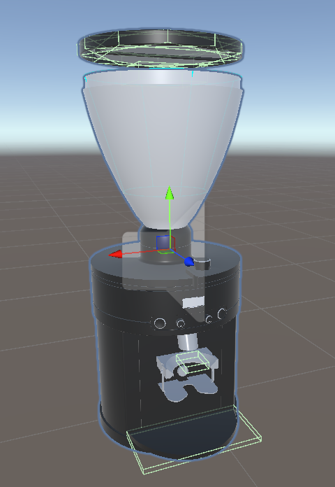
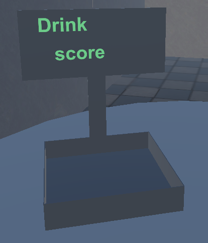
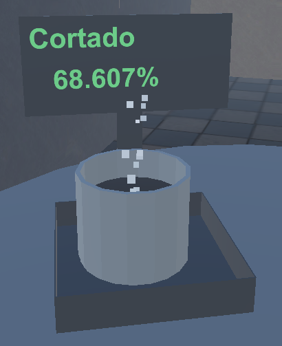

# MilkIt, Week 3: Coffee machine,  drink grading system

**Author:** Zygmunt Kwaśniewicz 

After the base requirement of actually having fluids and a way to generate them, the obvious next step was to have a proper implementation that the user can properly interact with. A problem we faced was that the process of creating coffee should be simple enough, that a player can more or less intuitively grasp it, but at the same time it has to require some physical steps, as simply pressing a button and watching the coffee be produced would quickly get boring and repetitive.

## Espresso machine
The solution to this issue was presented to us in the form of a great model found on sketchfab.
As there is no water intake, it greatly simplifies both implementation and usage, while the fact that it is an old-timey machine that requires a physical interaction, makes it much more satisfying to operate. Especially once the satisfying heavy clang of pulling the lever was added. 



### Flasks and snapping



An issue that took up a large amount of time was making the coffee puck flasks easy to use in the machine. Coffee pucks normally require a sort of screwing motion to lock them in place in the espresso machine, however replicating that movement would be challenging in VR. Furthermore the colliders placed in the **basket** of the flask made it impossible to follow real life behaviours. Instead a `FlaskDetector` was created which detected when an object with the `Flask` script entered its trigger, and then made the flask object into a child of a `attachmentPoint` while resetting the position to 0,0,0. Furthermore the `Flask` object stores a list of colliders which constitute the **basket** as such disabling the problematic colliders could be easily disabled.

### Leaver and source changing

Another purpose of the `FlaskDetector` was to switch which `fluidSource` was operated by the espresso machines lever. As without a puck attached the lever should trigger a flow of water from the machine itself, while with a puck connected, a flow of espresso from the flask. As such the `FlaskDetector` would update the main fluid source of a `SimpleLever`, a lever which based on the angle of the hinge and its max and min angle would calculate how fast the fluid source should flow.

## Coffee grinder

After the espresso machine and its components were defined, the next - or previous - step was to make a coffee grinder which turns coffee beans -> coffee grounds. While there were attempts to find an old-timey grinder, again, in hopes of making the action more manual and interesting, we finally settled on a modern esque model, which required simply loading the beans and pressing a button.



### Reusing flask snapping

An interesting implementation of the flask grabbing system was the top cover of the grinder, as the issues were quite similar to the flasks. The covering would fly off if we relied simply on physics to place it upon the grinder, it had to snap into its proper place, which again was rendered tough due to colliders. As such the top covering is technically a flask, that simply manages and provides no fluid source of its own.

## Drink grading

After preparing the path for creating fluids, the next step was to somehow grade what the user created, and how close they got to each of the possible recipes. While the grading is used in the payment functionality of the customer system, it can also be used by the user in before allowing the customers in, to learn how to make drinks properly.




### Fluid quality

Closely following a recipe is not the only important thing while serving customers, it is important that the user also pays attention to how they treat their ingredients. As such a quality system was implemented into some fluid levels. A fluid type can define a `qualityLossModel`, which is a scriptable object containing a single function updateQuality , and a tickDelay, which manages how often the updateQuality should be called. An example of such a function could be the `MustRefridgerate`.
```csharp
public class MustRefrigerate : QualityLossModel
    {
        public override float updateQuality(FluidContainer fluidContainer, float currentQuality)
        {
            if (fluidContainer.isRefrigerated) return currentQuality;
            return currentQuality * 0.995f;
        }
    }
```
This `QualityLossModel` was assigned to the milk fluid type.

### Drink type and scoring

However at the end of the day it is important that a customer who ordered an espresso gets an espresso, not a cortado. To allow for that a `DrinkType` was made, with the following data:
```csharp
public string name;
public int price;
public List<DrinkIngredient> ingredients;
public float expectedDrinkMililiters;
public Texture2D icon;
```
The `name` and `icon` were later used for the customer system, to communicate to the user what exactly they are supposed to make, while the `ingredients` and `expectedDrinkMililiters` are used in the scorer to check how well a passed list of fluidLayers matches this one.
```csharp
public float MatchScore(IReadOnlyList<FluidLayer> fluidLayers, float totalFluids)
{
    float totalError = 0;
    foreach (DrinkIngredient ing in ingredients)
    {
        if (!fluidLayers.Any(lay => lay.type == ing.type)) totalError += 1;
    }
    foreach (FluidLayer layer in fluidLayers)
    {
        DrinkIngredient matchingIngredient = ingredients.FirstOrDefault(ing => ing.type == layer.type);
        if (matchingIngredient == null)
        {
            totalError += 1;
            continue;
        }
        float diff = Mathf.Abs((layer.amount / totalFluids) - matchingIngredient.ingredientPercentageInDrink);
        float volumeDiff = Mathf.Abs(totalFluids - expectedDrinkMililiters) / Mathf.Max(totalFluids, expectedDrinkMililiters);
        totalError += diff + volumeDiff;
    }
    if (totalError > 4) return 0;
    return (4 - totalError) / 4;
}
```
this scorer was inspired by mean absolute error, as it increases error for each extra layer, each missing layer, and each difference in percentages of how much a given layer should take up of a given drink. Later on the `volumeDiff` was also added, which made it easier to establish a difference between a Flat white and a Caffee latte. Once this error has been calculated, we only calculate the score if error is less than 4. The score is simply 1 - error, with error being scaled to a range of 0 to 1.

## Looking back

The decision to keep the fluid production largely physical increased the satisfaction of the experience, perhaps making the grinder entirely manual would have been a good choice. The flask grabbing system should have been abstracted into a more broad item snapping functionality as it is a use case which seems to be widely in use. Grading system performance is entirely satisfactory.