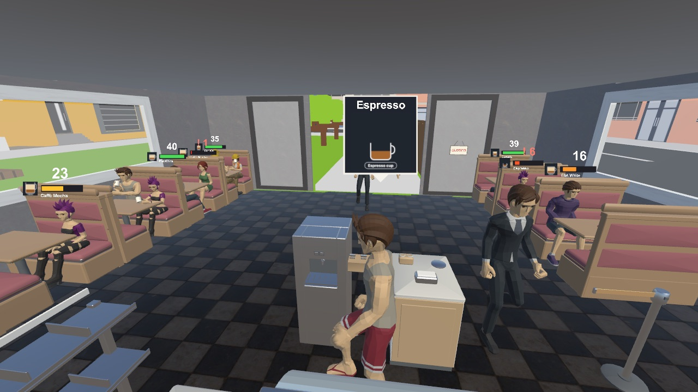
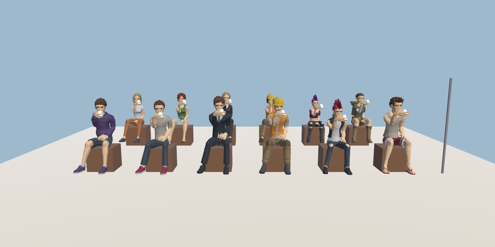
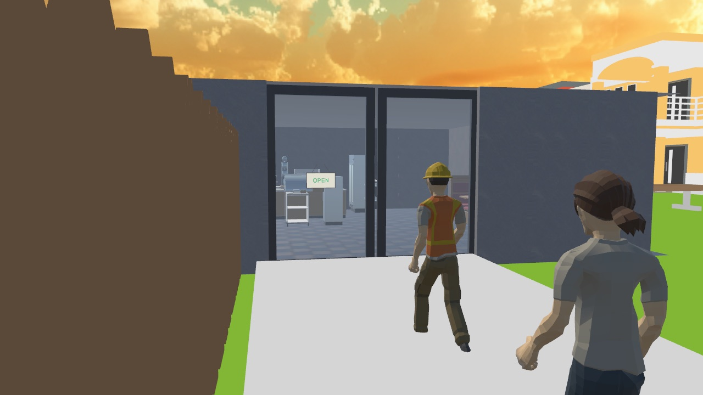
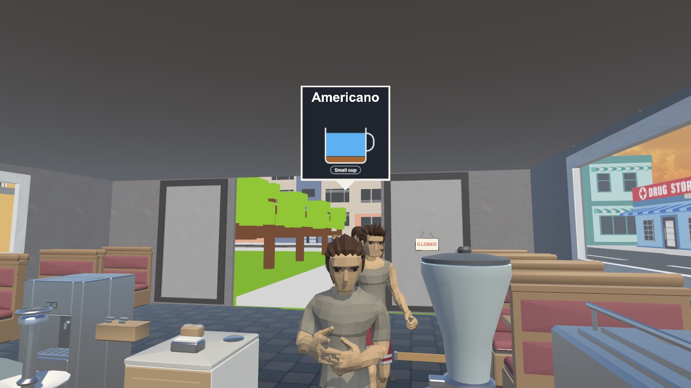
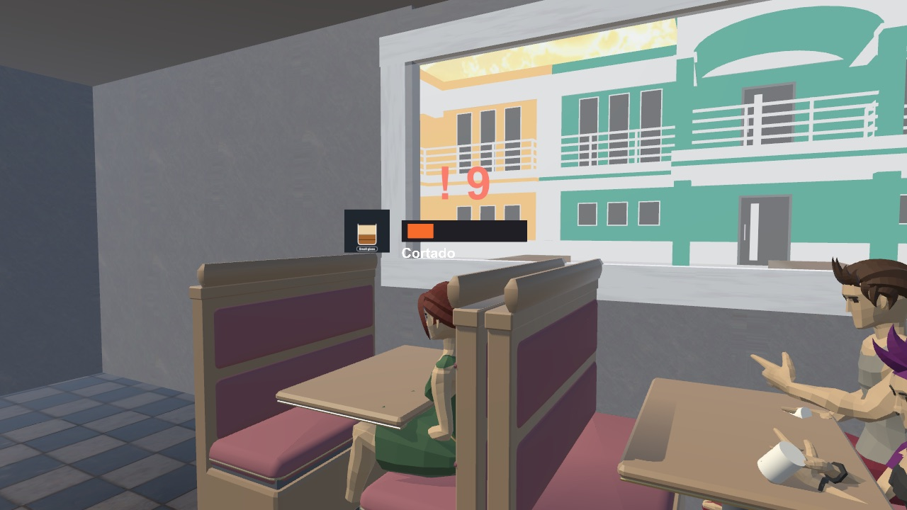

# MilkIt, Week 4: Customers and Ordering

**Author:** Josip Brljevic

Knowing how to make a coffee is only part of the job. In a real café you also take orders, remember who wants what and serve people before they get impatient. The goal for this week was to add customers who walk in, queue at the till, order, sit down, drink and pay, so the trainee practises in a situation close to a real shift.



## Characters and animations

We used the free **Ultimate Modular Men and Women** packs by Quaternius (CC0), which gave us 12 different outfits. Their built-in animations had no sitting or drinking, so we added Quaternius' **Universal Animation Library** and played its clips on our characters through Unity's **Humanoid retargeting**. This only worked with the packs' "Humanoid rig" versions, and every clip faced backwards, which a 180° offset at import fixed. The library has no free drinking clip, so we made one: a right-arm layer with an avatar mask that lifts the cup to the mouth while the rest of the body keeps sitting.



## Walking, queuing and sitting

Customers use a **NavMesh**, baked from simple boxes around walls, booths and the counter. We turned all seven booths into four-seat tables, and customers can arrive as a **party** of up to four, sit at the same table, chat and leave together. A deadlock appeared when a customer who had just ordered met the next person in a 40 cm gap next to the till. Making the flow one-way (leave the till along the counter, queue from the other side) solved it.

## Ordering in VR

Customers only come while the **OPEN/CLOSED sign** on the door says OPEN, so the trainee can also practise making drinks without anyone waiting.



At the till, a customer waits with a "?" until the trainee selects them with the controller ray or by poking them. Every customer gets a collider and an `XRSimpleInteractable` from the XR Interaction Toolkit. The collider has to be solid, because the ray ignores trigger colliders by default:

```csharp
var collider = gameObject.AddComponent<CapsuleCollider>();
collider.center = Vector3.up * 0.9f;
collider.height = 1.8f;
var interactable = gameObject.AddComponent<XRSimpleInteractable>();
interactable.selectEntered.AddListener(_ => cafe.TakeOrder(this));
```

The visit itself is one coroutine, so waiting at the till is just a loop until the trainee has selected them:

```csharp
State = CustomerState.WaitingAtTill;
bubble.ShowWaitingToOrder();
while (State == CustomerState.WaitingAtTill) yield return null;
bubble.ShowOrder(Drink, cafe.IconOf(Drink), false);
```



The bubble shows the cup from our coffee poster with the drink's name as 3D text. All of this lives in the world, because a normal on-screen UI is not visible in a headset.

## Patience and payment

When seated, each customer gets a timer above their head. The bar goes from green to red, the number turns into a red "! 4" when they get impatient, and if it runs out they leave without paying:

```csharp
while (State == CustomerState.WaitingForDrink)
{
    PatienceSecondsLeft = Mathf.Max(0f, patience - (Time.time - waitStarted));
    Frustrated = PatienceSecondsLeft / patience <= cafe.frustratedAt;
    if (PatienceSecondsLeft <= 0f) { State = CustomerState.LeavingAngry; break; }
    yield return null;
}
```



If they get their drink in time, they pay after finishing it. To connect this with the coffee machine and drink grading, every waiting customer has an invisible **hand-off zone** over them and their half of the table. Bringing a cup into it raises an event, and the drink-making code decides if the drink is good enough:

```csharp
cafe.DrinkHandedOver += (customer, cup) =>
{
    if (Grader.IsGoodEnough(cup, customer.Drink))
        cafe.TryDeliverDrink(customer.OrderId, customer.Drink);
};
```

## Looking back

The customers bring the pressure of a real shift into the training: the trainee has to notice who is waiting, remember what they ordered and serve them before they give up, just like behind a real counter. Keeping the customer logic separate from the drink making, with one event between them, also let both parts be built side by side.
